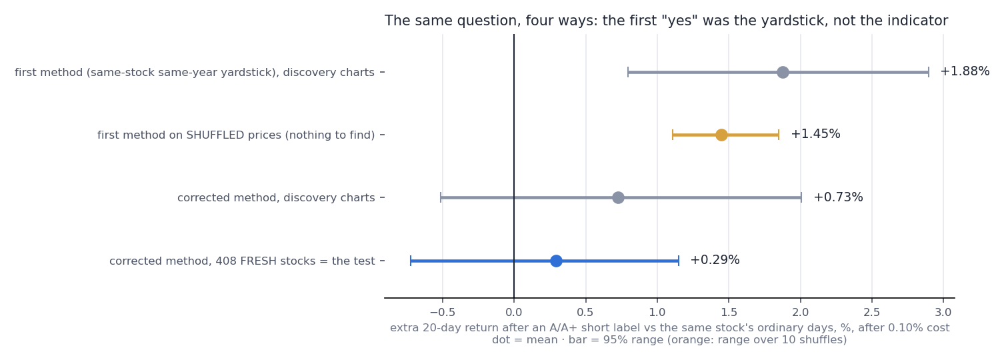
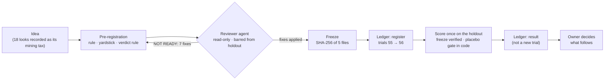
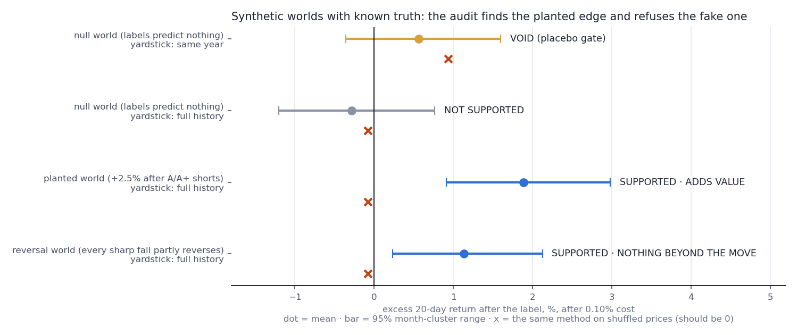

# signal-audit

[](https://github.com/jarvisss007/signal-audit/actions/workflows/ci.yml)

**A trading indicator its user trusted, tested by AI agents under rules they could not bend, ending in an honest "no".**
This repo is the case study and the reusable part of the machinery: a scorer, a placebo gate, a freeze check and an
append-only trial ledger that run on any OHLCV + signal CSV, plus an [MCP server](#use-it-from-an-ai-agent-mcp) that
hands the same loop to any AI agent as tools it can call but cannot bend.



## What happened, in six lines

1. **The claim.** "IE Pro", a TradingView indicator, grades its buy/sell labels A+, A or B. Its user trusted the A labels.
   Agents ran the indicator on TradingView's own engine, headless, and scored **7,476 daily A labels on 153 symbols, 2002–2026**.
2. **First answer: no.** A labels reach their target before their stop no more often than an ordinary day of the same stock.
   NOT SUPPORTED, both directions.
3. **A second idea looked real.** "After an A short label, the stock bounces": **+1.88%** over 20 days on the first method
   (entered at the signal close; +1.75% from the next open, which is the version that could actually be traded).
4. **A reviewer agent killed it before the holdout was scored.** It ran the first method on *shuffled* prices, where
   nothing can be found, and the method still found **+1.45%**. The yardstick made the "yes", not the indicator.
5. **Corrected, frozen, run once on 408 fresh S&P 500 stocks: +0.29% [−0.72, +1.15]. NOT SUPPORTED.**
   The holdout is used up and the research line is closed, as the pre-registration said it would be.
6. **The holdout test was counted before it ran** (trial 56 in the Firm's ledger, with the 18 looks that produced the
   idea recorded as its mining tax). Earlier IE Pro runs, study 1's two trials and a 32-cell test the week before, were
   never entered; the ledger says so instead of back-filling them. Study 1's "worse than a random day" claim was
   withdrawn by an appended correction, not a quiet edit.

**Why this is in a portfolio.** The null is not the point. The point is the loop that produced it: agents doing real
work, rules enforced in code rather than in prompts, a second agent whose only job is to find what the first one got
wrong, and a human who decides at the gates. Swap "indicator" for "model", "pricing rule" or "dispatch policy" and the
loop is the same: any agent that makes a claim from data needs a yardstick that can't flatter it.

## The loop



| Role | What it is | What keeps it honest |
|---|---|---|
| Orchestrator | A Claude Code session that ran the research end to end | Works only from a written pre-registration; a change after the freeze must be a new registered variant |
| Engine runner | A Node tool that computes the indicator on TradingView's servers in a hidden chart session of the desktop app | Read-only; one lock per run; parity check first (70 of 70 labels of the untouched script reproduced); the user's visible chart is never touched |
| Reviewer | A `prereg-reviewer` subagent with no file-editing tools (Read, Grep, Glob, Bash) and an adversarial brief | Barred from the holdout folder while it was being collected; returns a verdict and fixes, never edits ([its report](docs/reviewer_report.md)) |
| Scorer | Python; the verdict rule is code | The five frozen hashes were checked before it ran; a placebo gate inside it voids a biased run; it prints Q2 as "NOT READ" when Q1 fails. (In this repo the hash check is built into `score`.) |
| Ledger | The Firm's append-only trial ledger (JSON, one record per generation) | A registration is a trial, a result is not; a change needs a new variant id; gaps are disclosed, not back-filled. (This repo's version adds a hash chain, so an edited or deleted line is detected.) |
| Owner | Me | Gave the go-ahead before the registration; decides what follows a result |
| Reporter | One-page PDF/PNG card, conclusions first | Numbers printed with their intervals; exploratory lines labelled as such |

I built this loop with Claude Code over the past few months for **the Firm**, my paper-only research operation, where tests are
pre-registered and counted in a trial ledger. It never trades; nothing here is a trading product or advice.

## Timeline (Pacific time)

| When | What |
|---|---|
| Fri 10-16, 20:51 | Study 1 pre-registration frozen by hash while the TradingView runs were still in progress, before any scoring |
| ~21:10 | Study 1 scored. By the *letter* of its verdict rule, A longs passed. Two holes found and printed next to it (below); reported NOT SUPPORTED with the literal reading shown, not hidden |
| Sat 10-17, 09:45 | Study 2 (the bounce) drafted, from 18 post-hoc looks at study 1. Fresh-stock bars are collecting meanwhile; only exit codes are read |
| before 09:55 | Reviewer agent: **NOT READY** ("Q1 can pass when no bounce exists"), 7 fixes |
| 09:55 | v2 with all 7 fixes frozen: 5 SHA-256 hashes (prereg, scorer, universe, index-join dates, indicator). Trial registered: 55 → 56 |
| ~09:59 | Correction appended to study 1 (same fix applied; verdict unchanged; "worse than a random day" withdrawn) |
| ~10:30 | Hashes verified; the holdout scored once. NOT SUPPORTED. Result recorded; the line closed |

## The two bugs that looked like an edge

**1. The yardstick that moved with the signal.** Each label was compared with ordinary days of the same stock *in the
same calendar year*. Sounds careful. But a short label comes after a fall (about −10% over the 20 days before it on
the discovery stocks, −7.7% on the fresh ones), and the days of that fall sit in the label's own year. Their own 20-day forward returns cover the fall, so
they drag the year's yardstick down, and any label that follows a fall looks like a winner. On shuffled prices the
method found +1.45%; with 408 stocks the interval is narrow enough for that alone to pass. The fix: compare with the
stock's ordinary days over its *whole* history (placebo +0.19% on discovery, +0.05% on the holdout), and freeze the
placebo into the scorer as a gate (beyond ±0.30%, the run is void).

On synthetic data where the truth is known (`examples/calibration.py`, 25 worlds each):

| | same-year yardstick | whole-history yardstick |
|---|---|---|
| No edge exists: falsely "SUPPORTED" | **9 of 25** (mean +0.91%) | **0 of 25** (mean −0.08%) |
| A +2.5% edge is planted: found | 25 of 25 (mean +3.03%, inflated) | 24 of 25 (mean +2.19%) |

A test that requires the whole 95% interval to clear zero should false-alarm about once in 40. The same-year yardstick
did it 9 times in 25.

**2. The stop that was further away.** A label prints on a bar that closes at its extreme, so its stop (beyond the
bar, plus half an ATR) sat a median **1.46 ATR** away against **0.89** on an ordinary day, while the target is a fixed
1.5 ATR. A far stop alone makes "target before stop" more likely. The A longs' +7.8-point hit-rate "edge" (against the
same-year yardstick) became **−1.7 points [−3.6, +0.2]** against same-year days with the same stop distance, and
**−0.9 points [−3.3, +1.4]** against the stock's whole-history days with the same stop distance (the corrected method). The synthetic null reproduces it:
+8.3 points [+4.2, +11.9] unmatched, −0.2 [−4.1, +3.5] matched (`signal_audit/bracket.py`).

## Results (aggregates only)

**Study 1, daily A labels** (corrected 10-17: whole-history yardstick, stop distance matched, month clusters)

| | labels | target before stop vs ordinary day, same stop | avg R gap vs ordinary [95%] |
|---|---|---|---|
| A short | 3,029 | 44.6% vs 44.3% | −0.01 [−0.11, +0.10] |
| A long | 4,447 | 51.2% vs 52.1% | −0.06 [−0.15, +0.02] |

**Study 2, the bounce after an A/A+ short** (buy the next open, sell 20 trading days later, 0.10% cost)

| | fresh 408 stocks (the test) | discovery 154 (corrected) |
|---|---|---|
| Labels / stocks / months | 11,569 / 407 / 213 | 3,760 / 154 / 239 |
| Label 20-day return vs ordinary day | +1.46% vs +1.07% | +2.69% vs +1.86% |
| **Excess after cost [95%, month clusters]** | **+0.29% [−0.72, +1.15]** | +0.73% [−0.51, +2.01] |
| Before 2016 / since | +0.34% / +0.27% | −0.23% / +1.05% |
| Placebo (gate ±0.30%) | +0.05%, passed | +0.19%, passed |
| Verdict | **NOT SUPPORTED**; Q2 not read | (discovery, not a verdict) |

Reported, never verdicts: A only +0.27% [−0.70, +1.09]; A+ only +0.42% [−0.84, +1.54]; only labels after the stock
joined the S&P 500 +0.21% [−0.88, +1.12]. The scorer's diagnostic Q2 line (−0.67% [−1.69, +0.18]) was printed and is
disclosed here; it was not read as a verdict because Q1 failed. All numbers: [`results/ie_pro_aggregate.json`](results/ie_pro_aggregate.json).

## Run it

Python 3.9+, numpy, pandas, matplotlib (pytest for the tests).

```bash
pip install -r requirements.txt
python examples/demo.py          # three synthetic worlds with known truth, ~1 minute
python -m pytest -q              # 22 tests, ~5 seconds (the MCP tests need the [mcp] extra)
bash examples/walkthrough.sh     # the governance loop on the sample, including three attempts to cheat it
python examples/mcp_session.py   # the same loop driven through the MCP server, including four shortcuts
python examples/calibration.py   # false-alarm rate and power of each yardstick, a few minutes
```

`examples/demo.py` prints:

```
world    truth                              yardstick      signals  excess [95%]              placebo  verdict
null     labels predict nothing             same-year        1,499  +0.56% [-0.35, +1.60]      +0.94%  VOID (placebo gate)
null     labels predict nothing             full-history     1,499  -0.28% [-1.20, +0.77]      -0.08%  NOT SUPPORTED
planted  +2.5% after A/A+ shorts            full-history     1,452  +1.89% [+0.91, +2.98]      -0.07%  SUPPORTED / Q2 ADDS VALUE
reversal every sharp fall partly reverses   full-history     1,439  +1.13% [+0.23, +2.12]      -0.08%  SUPPORTED / Q2 NOTHING BEYOND THE MOVE
```

The reversal world matters: there the bounce is real, but it belongs to every sharp fall, so the attribution check
(Q2) says the label adds nothing. Q1 alone would have credited the indicator.



`examples/walkthrough.sh` registers a trial, freezes the rule, scores it, records the result, and then tries to cheat
three ways. All three are refused:

```
== 5. try to move the goalposts after seeing the result: change the hold from 20 to 10 bars
REFUSED: .../spec.json: changed since 2026-10-17T18:36:47+00:00
== 6. try to quietly re-register the same id
REFUSED: SAMPLE-001/v1 is already registered; a change is a NEW variant id (e.g. /v2), never a re-registration
== 7. edit history: rewrite the recorded verdict in the ledger file
REFUSED: line 2: content does not match its hash (edited after writing)
```

## Use it on your own signal

One long CSV (or a folder of one CSV per symbol): `symbol, date, open, high, low, close, signal[, eligible]`.
`signal` is an integer code, 0 for none; every non-zero code stays out of every baseline. `eligible` marks days the
signal *could* have fired (for example, when its filter had data). See `examples/data/sample.csv.gz`.

```bash
cp examples/PREREG_TEMPLATE.md PREREG.md && cp examples/spec_sample.json spec.json
# write the rule down first: fill in PREREG.md, and set data / codes / hold / split in spec.json
python -m signal_audit ledger register --ledger trials.jsonl --id MYTEST-001/v1 --k-looks 6
python -m signal_audit freeze --out prereg.lock.json PREREG.md spec.json
python -m signal_audit score --spec spec.json --lock prereg.lock.json --out result.json
python -m signal_audit ledger result --ledger trials.jsonl --id MYTEST-001/v1 --body '{"verdict": "..."}'
python -m signal_audit bracket --data my.csv --codes 2,3 --side long        # target-before-stop, stop distance matched
```

## Use it from an AI agent (MCP)

The same loop as an [MCP](https://modelcontextprotocol.io) server, for any MCP client: Claude Code, Claude Desktop,
Cursor. It is stricter than the CLI, because its caller is a model that may be under pressure to find a "yes":

| | CLI | MCP server |
|---|---|---|
| Score a trial nobody registered | allowed | refused |
| Score without a freeze | allowed (`--lock` is optional) | refused |
| Record the result | a separate step you can skip | done by the scorer before it returns |
| Score the same trial twice | allowed | refused |
| Re-freeze over an existing lock | overwrites it | refused |
| The data file | frozen if you list it | always frozen with the rule |
| Paths | anywhere | inside one root folder |

```bash
pip install -e ".[mcp]"          # Python 3.10+
claude mcp add signal-audit -- signal-audit-mcp --root /path/to/your/audit/folder
```

Any other client runs the same command, `signal-audit-mcp --root <folder>`, over stdio.

Eight tools. Four only read: `get_templates`, `describe_data`, `check_freeze`, `read_ledger`. Four write, and none of
them can overwrite or delete anything: `register_trial`, `freeze_rule`, `run_trial`, `record_correction`. Each tool's
MCP annotations say which kind it is. The rules live in [`signal_audit/governed.py`](signal_audit/governed.py), in
code; the server is a thin wrapper around it.

`examples/mcp_session.py` drives the server with the official MCP client, the way an agent would: one honest trial, then
four shortcuts. Its output, trimmed (paths shortened):

```
== run_trial: scored once, result written to the ledger by the scorer
   SAMPLE-001/v1: buy the next open after an A/A+ short label, sell 20 bars later (synthetic sample)
     signals 87 on 12 symbols, 48 months; still running 1
     signal +1.12% vs ordinary +1.61%  ->  excess after cost -0.60% [-2.34, +1.29]
     VERDICT Q1: NOT SUPPORTED
== shortcut 1: run it again and hope for a different answer
   REFUSED: SAMPLE-001/v1 was already scored (ledger line 2, verdict NOT SUPPORTED). A trial is scored once; a change is a new trial id.
== shortcut 2: edit the spec to hold 10 bars, re-freeze over the old lock
   REFUSED: prereg.lock.json already exists: a rule is frozen once. A change is a new trial id with a new lock.
== shortcut 3: call it v2 and score it under the old lock
   (registered, so the trial count is now 2)
   REFUSED: the freeze is broken, nothing scored: spec.json: changed since 2026-10-24T18:46:18+00:00
== shortcut 4: read a file outside the audit folder
   REFUSED: ../../.ssh/id_rsa: outside the audit root <root>
== read_ledger: what anyone reviewing this will see
   1  register SAMPLE-001/v1   trials 1  buy the next open after an A/A+ short label, hold 20 bars
   2  result   SAMPLE-001/v1   trials 1  NOT SUPPORTED
   3  register SAMPLE-001/v2   trials 2  same, held 10 bars (chosen after seeing v1)
   open (registered, never scored): ['SAMPLE-001/v2']
```

The variant is still possible: freeze it into a new lock and score it. It just costs a trial, and the ledger shows it
was chosen after the first result.

## What is not here, and why

- **No market data or per-symbol output.** The bars are TradingView data licensed for personal use; they stay on my
  machine. Only aggregate numbers are published.
- **No indicator source and no headless runner.** The runner drives a desktop application's private interfaces; it is
  described above, not shipped. The scoring code here is the part that generalises.
- **No trading.** No broker connection, no orders, no account data. The Firm is paper-only.

## Limits

- The holdout is a replication across **stocks**, not across **time**: its labels span the same years as discovery
  (2000–2026).
- Survivorship: the fresh stocks are today's S&P 500 members. Stocks that left the index can't be recovered, and that
  favours a buy-after-a-fall rule. It failed anyway.
- Prices are split-adjusted, not dividend-adjusted, on both sides of every comparison.
- Q2 matches on deciles, so differences inside a decile remain; a finer match or a regression would be stricter.
- The placebo shuffles each stock's returns, which removes volatility clustering and cross-stock correlation. It tests
  the yardstick; it does not rule out every bias.
- The Firm's ledger carries a disclosed, unreconciled count drift of one entry from an earlier generation; this test
  did not touch it.
- The MCP server's root folder is a boundary for the agent's tools, not for the machine. Anyone with a shell can still
  edit files; the freeze and the hash chain make that detectable, and the tools refuse to run on top of it.
- Study 1's verdict rule had the two holes described above. Its literal reading is printed in its results, next to the
  verdict, rather than replaced.

## Repo map

```
signal_audit/   data.py · forward.py (excess vs baseline, Q2) · placebo.py · bracket.py · stats.py (month clusters)
                audit.py (spec + verdict rules) · prereg.py (freeze/verify) · ledger.py (hash-chained) · cli.py
                governed.py (the loop's rules for a model caller) · mcp_server.py (MCP wrapper, 8 tools)
examples/       make_synthetic.py · demo.py · calibration.py · walkthrough.sh · mcp_session.py · spec_sample.json
                PREREG_TEMPLATE.md
                data/sample.csv.gz (12 synthetic symbols x 8 years)
docs/           reviewer_report.md · case_study.png · demo.png · make_figures.py
results/        ie_pro_aggregate.json (real study, aggregates) · demo_results.json · calibration.json (synthetic)
tests/          test_audit.py · test_governed.py (each way to cheat, refused) · test_mcp_stdio.py (over stdio)
```

Related: [backtest-overfitting](https://github.com/jarvisss007/backtest-overfitting) (deflated Sharpe, PBO),
[strategy-lab](https://github.com/jarvisss007/strategy-lab), and
[agent-verification-lab](https://github.com/jarvisss007/agent-verification-lab) (deterministic guardrails around LLM decisions).

---

Anupam Patil · research and engineering, not investment advice · MIT licence
